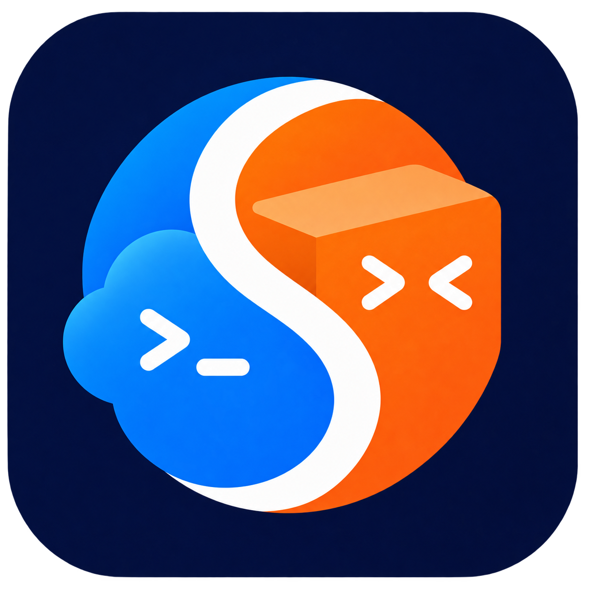
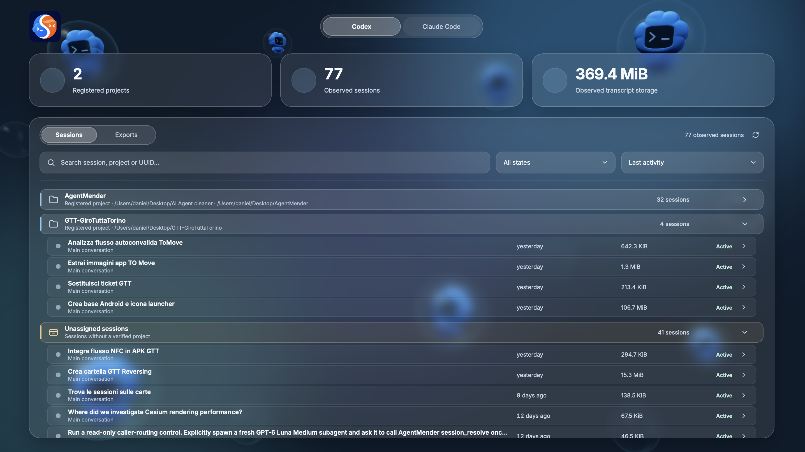
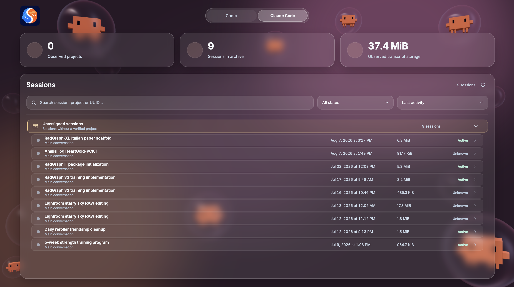

<p align="center">
  
</p>

<h1 align="center">SessionMender</h1>

### How it works

SessionMender is a local application for managing and cleaning up Codex and Claude Code sessions through a unified browser-based interface.

It automatically finds your local sessions and lets you easily search, filter, and preview conversations to decide what to keep or delete.

This helps you free up disk space and keep your workspace organized.

<p align="center">
  
</p>

<p align="center">
  
</p>

## Install

Clone the repository and install SessionMender globally.

```sh
git clone https://github.com/therabo/SessionMender.git
cd SessionMender
npm install -g .
```

Launch SessionMender from any directory.

```sh
session-mender
```
